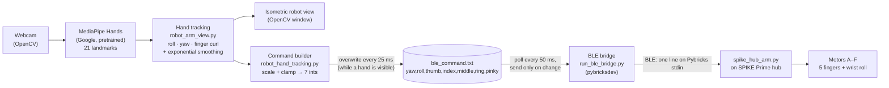

# Vision-Guided Remote Robotic Hand

A LEGO robotic hand that copies your hand from a webcam, built as a **KAIST CS270 team project, Spring 2026**. A laptop runs Google's pretrained **MediaPipe Hands** model on the webcam feed. The project's own tracking code turns the 21 hand landmarks into wrist roll, elbow yaw and five finger-curl values, smooths them, and writes them out as a 7-value command. A small BLE bridge sends each new command to a LEGO SPIKE Prime hub running a [Pybricks](https://pybricks.com) program, and the hub drives one motor per finger plus wrist roll. A live window shows the camera feed next to an isometric view of the robot arm. The repo also has a set of scripted "task" demos (handshake, watering, rock-paper-scissors and others) that play preset motor timelines on the same hand.

> Originally developed in [himanii777/Robotic-Arm](https://github.com/himanii777/Robotic-Arm). This repository is a documented copy of that project. It includes the `feat/roll-yaw` work used in the final demo, merged into `main`.

## Demo

- [Demo video — link TBD](TODO)

## Architecture



More detail: [docs/ARCHITECTURE.md](docs/ARCHITECTURE.md), [docs/BLE_PROTOCOL.md](docs/BLE_PROTOCOL.md), [docs/HARDWARE.md](docs/HARDWARE.md).

## Hardware and hub/port map

- LEGO SPIKE Prime hub(s) running **Pybricks firmware**, with LEGO SPIKE motors. One SPIKE Prime hub has **6 motor ports (A–F)**.
- The hand needs 7 axes (5 fingers, wrist roll, elbow yaw), which is more than one hub can drive. The design therefore uses **two hubs**: `friday` for the fingers and wrist roll, and `monday` for yaw.
- **Yaw is currently disabled** ("lack of hardware"). The yaw mapping in `spike_hub_arm.py` is commented out, so only the fingers + roll hub is driven. The yaw value is still computed and sent.

Live tracking pipeline (`spike_hub_arm.py`):

| Hub | Port | Motor | Command field |
|---|---|---|---|
| `friday` | A | Thumb | 3 |
| `friday` | B | Index finger | 4 |
| `friday` | C | Middle finger | 5 |
| `friday` | D | Ring finger | 6 |
| `friday` | E | Pinky finger | 7 |
| `friday` | F | Wrist roll | 2 |
| `monday` | F | Elbow/wrist yaw (**disabled** in code) | 1 |

Note: because yaw is disabled, `spike_hub_arm.py` maps the same six ports (A–E fingers, F roll) on whichever hub it runs on. Motors that aren't connected are skipped.

The scripted task demos (`Roboarm_tasks/hub_pybricks_receiver.py`) use a **different** single-hub map: A wrist, B thumb, C index, D ring, E pinky, F middle. Yaw is ignored there. See [docs/HARDWARE.md](docs/HARDWARE.md).

## Setup

Requirements: a webcam, Python **>=3.10,<3.14** (from `pyproject.toml`; `.python-version` pins **3.11**, which `uv` will use), and [uv](https://docs.astral.sh/uv/). For hardware: a SPIKE Prime hub flashed with Pybricks firmware (via <https://code.pybricks.com>) and a Bluetooth LE adapter on the laptop.

```bash
# install uv (macOS/Linux); on Windows see https://docs.astral.sh/uv/
curl -LsSf https://astral.sh/uv/install.sh | sh

git clone <this-repo-url> vision-guided-robotic-hand
cd vision-guided-robotic-hand
uv sync
```

Dependencies (from `pyproject.toml`): `bleak`, `mediapipe==0.10.9`, `numpy==1.26.4`, `opencv-contrib-python`, `matplotlib`, `sounddevice`, `pybricksdev`.

Without uv, use the same list with pip:

```bash
python -m venv .venv && source .venv/bin/activate
pip install "bleak>=0.22.3" "mediapipe==0.10.9" "numpy==1.26.4" "opencv-contrib-python>=4.8.0" \
            "matplotlib>=3.7.0" "sounddevice>=0.4.6" "pybricksdev>=1.0.0"
```

`requirements.txt` is older and incomplete: it lists only `bleak`, `numpy` and a different MediaPipe pin (`0.10.35`). Use `pyproject.toml` / `uv.lock` instead. If MediaPipe fails with `Output tensor range is required`, check that the installed version is `0.10.9`:
`uv run --no-sync python -c "import mediapipe as mp; print(mp.__version__)"`.

On macOS, give your terminal or IDE camera access (System Settings → Privacy & Security → Camera), then restart it.

## Running

Run every command **from the repository root**. `ble_command.txt` and `spike_hub_arm.py` are opened by relative path.

### 1. Live hand → robot hand (the demo pipeline)

Terminal 1, the BLE bridge. It finds the hub, uploads and starts `spike_hub_arm.py`, then forwards commands:

```bash
uv run --no-sync python run_ble_bridge.py --hub friday
```

| Flag | Default | Meaning |
|---|---|---|
| `--hub` | `monday` | BLE name of the SPIKE hub to connect to. |
| `--poll-interval` | `0.050` | Seconds between reads of `ble_command.txt`. |

Terminal 2, the tracker:

```bash
uv run --no-sync python robot_hand_tracking.py
```

Keys in the window: `c` calibrates the current hand pose as neutral roll/yaw, `r` resets neutral and filters, `q`/`Esc` quits.

### 2. Vision only (no hardware)

`robot_hand_tracking.py` runs without a hub. It still writes `ble_command.txt`, but nothing reads it. For raw landmarks only:

```bash
uv run --no-sync python hand_tracking.py   # --camera, --width, --height, --max-hands, --model-complexity
```

### 3. Scripted task demos (`Roboarm_tasks/`)

```bash
# rehearsal: print the motor timeline, no hardware
uv run --no-sync python Roboarm_tasks/Handshake.py --mode do-task --driver console
# hardware: hub must be running Roboarm_tasks/hub_pybricks_receiver.py (see docs/HARDWARE.md)
uv run --no-sync python Roboarm_tasks/Handshake.py --mode do-task --driver ble --hub-name "friday"
```

Scripts: `Handshake.py`, `Watering.py`, `Dogpoop.py`, `Emotional_support.py`, `Scratcher.py`, `Djhand.py`, `rock_scissors.py`. Common flags (from `task_runtime.py`): `--driver {console,ble}` (default `console`), `--hub-name` (default `"Pybricks Hub"`), `--hub-timeout` (15 s), `--camera`, `--width`, `--height`, `--no-preview`, `--voice`, `--songs-dir`, `--pause-scale` (1.0), `--skip-countdown`. See [Roboarm_tasks/README.md](Roboarm_tasks/README.md).

## Tracking and calibration flags (`robot_hand_tracking.py`)

| Flag | Default | Effect |
|---|---|---|
| `--camera` | `0` | OpenCV camera index. |
| `--width` / `--height` | `960` / `540` | Requested camera resolution. |
| `--max-hands` | `2` | Hands MediaPipe tracks. The hand with the largest palm (wrist→middle-MCP distance) controls the robot. |
| `--model-complexity` | `0` | MediaPipe model: `0` faster, `1` possibly more accurate. |
| `--robot-panel-width` | `420` | Width (px) of the isometric robot panel. |
| `--roll-limit` | `70.0` | Symmetric roll limit (deg). Applied in tracking and again after scaling. |
| `--yaw-limit` | `60.0` | Symmetric yaw limit (deg). Applied in tracking and again after scaling. |
| `--yaw-gain` | `1.0` | Multiplier on the combined yaw estimate. |
| `--yaw-translation-gain` | `140.0` | Degrees of yaw per full-frame horizontal wrist displacement. |
| `--yaw-wrist-gain` | `0.85` | Multiplier from wrist/palm yaw angle to yaw. |
| `--roll-smoothing` | `0.22` | Exponential smoothing factor for roll (higher = more responsive). |
| `--yaw-smoothing` | `0.14` | Smoothing factor for yaw (lower = steadier). |
| `--finger-smoothing` | `0.35` | Smoothing factor for finger curl. |
| `--roll-tolerance` | `1.5` | Deadband (deg) around neutral that is sent as 0. Also the snap threshold. |
| `--update-rate-ms` | `25` | Minimum ms between command-file writes / console prints. |
| `--scale-yaw` | `1.5` | Yaw output multiplier. |
| `--scale-roll` | `1.0` | Roll output multiplier. |
| `--scale-thumb` | `-6.5` | Thumb multiplier. Negative reverses motor direction. |
| `--scale-index` | `2.5` | Index finger multiplier. |
| `--scale-middle` | `2.5` | Middle finger multiplier. |
| `--scale-ring` | `1.9` | Ring finger multiplier. |
| `--scale-pinky` | `1.9` | Pinky multiplier. |
| `--snap-roll` | off | Send roll as `±snap-roll-value` or `0` instead of continuous tracking (marked "not tested" in the original notes). |
| `--snap-roll-value` | `120.0` | Roll value used by `--snap-roll`. |
| `--hub-name`, `--hub-timeout` | `monday`, `15.0` | Parsed but **not used** in the current file-based mode. The bridge's `--hub` picks the hub. |

Finger motor target = `clamp(curl × 450 × scale, −450, 450)`, where `curl` ranges from 0 (open) to 1 (closed). The scale defaults are the hand-tuned values from the final build. See the calibration procedure in [docs/HARDWARE.md](docs/HARDWARE.md).

## Project structure

```
.
├── robot_hand_tracking.py       # main app: webcam → MediaPipe → mapper → robot view + command file
├── robot_arm_view.py            # roll/yaw/finger-curl estimation, smoothing, isometric robot renderer
├── hand_tracking.py             # minimal MediaPipe landmark demo
├── run_ble_bridge.py            # laptop BLE bridge: uploads spike_hub_arm.py, forwards ble_command.txt
├── spike_hub_arm.py             # Pybricks program for the hub (7-value command → motors)
├── tests/
│   ├── simple_hub_program.py    # hub side: one motor on port F follows an angle
│   └── simple_laptop_send.py    # laptop side: type angles, sent over BLE (hardware test)
├── Roboarm_tasks/               # scripted task demos with their own BLE sender/receiver
│   ├── task_runtime.py          # shared runner: poses, safe limits, CLI, camera/audio helpers
│   ├── spike_ble_bridge.py      # bleak-based sender (M,<ms>,v1..v7 protocol)
│   ├── hub_pybricks_receiver.py # hub-side receiver for the task demos
│   ├── Handshake.py, Watering.py, Dogpoop.py, Emotional_support.py,
│   │   Scratcher.py, Djhand.py, rock_scissors.py
│   ├── songs/                   # put local .mp3/.wav here (git-ignored)
│   └── README.md
├── docs/
│   ├── ARCHITECTURE.md, BLE_PROTOCOL.md, HARDWARE.md
│   ├── Robotic_Arm_presentation.pptx
│   └── Robotics_plan.pdf
├── pyproject.toml, uv.lock, .python-version, requirements.txt
└── ble_command.txt              # created at runtime, git-ignored
```

## Team & credits

| Member | Contributions (verified against git history) |
|---|---|
| **Babahan Babakulyyev** ([@Babahan-0906](https://github.com/Babahan-0906)) | BLE bridge `run_ble_bridge.py`; hub program `spike_hub_arm.py`; tracking → 7-value command output in `robot_hand_tracking.py` (file IPC, per-motor scaling, roll snapping); motor scaling calibration; hardware tests in `tests/`; hub/port mapping docs |
| **Samuel Dawit Assefa** | Hand tracking and estimation (`hand_tracking.py`, `robot_arm_view.py`: roll, yaw, finger curl, smoothing, `c`/`r` calibration); isometric 3D robot visualization; original `robot_hand_tracking.py`; uv project setup and original README |
| **himanii777** | Scripted task demos in `Roboarm_tasks/` (`task_runtime.py` and the task scripts); original BLE bridge (`spike_ble_bridge.py`) and hub receiver (`hub_pybricks_receiver.py`); project plan and presentation in `docs/` |
| **TBD — ask Babahan** | Built the LEGO robotic arm/hand hardware |

Hand landmark detection uses **MediaPipe Hands**, a pretrained model from Google (<https://github.com/google-ai-edge/mediapipe>). This project did not train any model. Hub-side code runs on [Pybricks](https://pybricks.com), and the laptop-side upload uses [pybricksdev](https://github.com/pybricks/pybricksdev).

## License

No license has been chosen yet.
