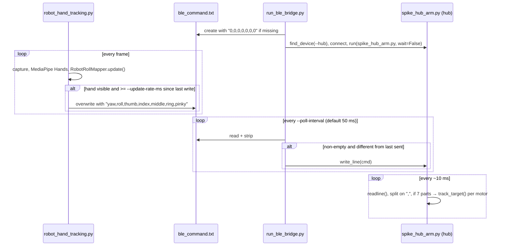

# Architecture

This page covers the **live tracking pipeline** used in the final demo (`robot_hand_tracking.py` → `run_ble_bridge.py` → `spike_hub_arm.py`). The scripted task demos in `Roboarm_tasks/` are a separate path, covered at the end.

## Processes

The pipeline runs as three independent programs. They talk to each other only through a file and a BLE link.

| # | Program | Runs on | Concurrency model |
|---|---|---|---|
| 1 | `robot_hand_tracking.py` | Laptop | One process, one thread: a synchronous `while True` frame loop |
| 2 | `run_ble_bridge.py` | Laptop | One process, a single `asyncio` event loop |
| 3 | `spike_hub_arm.py` | SPIKE Prime hub (Pybricks MicroPython) | A single `while True` loop |

Programs 1 and 2 share **`ble_command.txt`** in the current working directory, so start both from the repo root. Program 2 uploads and starts program 3 over BLE, then writes command lines to the hub's stdin.

## 1. Tracking process (`robot_hand_tracking.py` + `robot_arm_view.py`)

Each loop iteration does the following:

1. **Capture.** `cv2.VideoCapture(--camera)` reads a frame, which is mirrored (`cv2.flip(frame, 1)`) and converted to RGB.
2. **Landmarks.** `mediapipe.solutions.hands.Hands` (Google's pretrained model; `static_image_mode=False`, `max_num_hands=--max-hands`, `model_complexity=--model-complexity`, detection/tracking confidence 0.5) returns 21 normalized landmarks per hand.
3. **Primary hand.** `select_primary_hand` picks the hand with the largest wrist→middle-MCP distance, which is usually the hand closest to the camera.
4. **Estimation** (`RobotRollMapper.update`):
   - **Roll**: angle of the index-MCP→pinky-MCP vector, measured relative to a neutral angle. The neutral is captured on the first frame with a hand, or when you press `c`. It is clamped to `±--roll-limit`.
   - **Yaw**: `(wrist_x − neutral_wrist_x) × --yaw-translation-gain + (wrist-yaw angle − neutral) × --yaw-wrist-gain`, then multiplied by `--yaw-gain` and clamped to `±--yaw-limit`. The wrist-yaw angle is the direction of the wrist→middle-MCP vector.
   - **Smoothing**: first-order exponential filter, `filtered += α × (target − filtered)`, with α = `--roll-smoothing` / `--yaw-smoothing` (each clamped to 0.01–1.0).
   - **Deadband**: if |filtered| < `--roll-tolerance`, the command is 0. This applies to both roll and yaw.
   - **Finger curl** (`extract_finger_pose`): landmarks are moved into a palm-aligned 2D frame and normalized by palm size. Each finger gets a 0–1 curl from joint bend angles, reach and straightness (the thumb uses its own extension rule). Curl is then smoothed with `--finger-smoothing`.
5. **Visualization.** `RobotArmIsoView.draw` renders an isometric projection of a 3D arm model (base, elbow yaw, wrist roll, five fingers) next to the camera image. If no hand is visible it shows "HOLDING LAST".
6. **Command output.** Only when a hand is tracked and at least `--update-rate-ms` (default 25 ms) has passed since the last write:
   - `yaw = clamp(command_yaw × --scale-yaw, ±--yaw-limit)`
   - `roll = clamp(command_roll × --scale-roll, ±--roll-limit)`, or with `--snap-roll`: `±--snap-roll-value` when |roll| exceeds `--roll-tolerance`, otherwise 0
   - `finger = clamp(curl × 450 × --scale-<finger>, −450, 450)`
   - Each value is truncated with `int()` and the line `yaw,roll,thumb,index,middle,ring,pinky` overwrites `ble_command.txt`. The same values are printed to the console.
7. **Keys.** `c` sets the current pose as neutral, `r` resets neutral and filters, `q`/`Esc` exits.

If no hand is visible, nothing is written. The file keeps the last command, so the hub holds its last targets.

## 2. Bridge process (`run_ble_bridge.py`)

- Uses `pybricksdev` (`find_device`, `PybricksHubBLE`).
- On start: creates `ble_command.txt` with `0,0,0,0,0,0,0` if it is missing, connects to the hub named `--hub`, then calls `hub.run("spike_hub_arm.py", wait=False)`. This compiles the program, downloads it to the hub and starts it.
- Main loop: read the file every `--poll-interval` seconds (default 0.050). If the stripped content is non-empty and differs from the last line sent, call `hub.write_line(cmd)`. File read errors are silently ignored.
- On Ctrl+C: disconnects from the hub.

The bridge does **send-on-change** only. A held pose produces no BLE traffic, and intermediate values written between two polls are skipped. The file is overwritten in place with no locking. If a read lands on a half-written line, the hub drops it unless it has exactly 7 fields.

## 3. Hub program (`spike_hub_arm.py`)

- Creates `Motor` objects for ports A–E (fingers) and F (wrist roll) and calls `reset_angle(0)` on each. **The motor's position at program start becomes zero.** Ports with no motor (`OSError`) are skipped.
- Loops on `sys.stdin.readline()`. Lines without exactly 7 comma-separated fields are ignored. Each field is parsed with `int(float(...))` and sent to `Motor.track_target(angle)` for motors that exist. Yaw (field 1) is currently dropped because no yaw motor is mapped.
- `wait(10)` between iterations.

See [BLE_PROTOCOL.md](BLE_PROTOCOL.md) for the line format.

## Timing parameters (from the code)

| Where | Parameter | Default |
|---|---|---|
| Tracker | `--update-rate-ms` (minimum interval between file writes) | 25 ms |
| Bridge | `--poll-interval` (file read period) | 50 ms |
| Hub | loop `wait()` | 10 ms |

End-to-end latency and frame rate were not measured in this repo (**TBD**). The tracker shows a live FPS estimate in its HUD.

## Scripted task demos (`Roboarm_tasks/`)

This is a separate path that does not use `ble_command.txt`:

- Each task script (e.g. `Handshake.py`) builds a timeline of poses with `ArmController` from `task_runtime.py`. Targets are clamped to `SAFE_LIMITS`. Unknown motor names are skipped. `wrist_pitch` and `wrist_roll` are treated as aliases of `wrist`.
- `--driver console` only prints the timeline. `--driver ble` sends it through `SpikeBleBridge` (`spike_ble_bridge.py`). That bridge runs `bleak` in a **background thread** with its own `asyncio` loop, fed by a `queue.Queue`, so task scripts can call it synchronously.
- The hub must already be running `hub_pybricks_receiver.py`, started from the hub button. This path does not upload a program.
